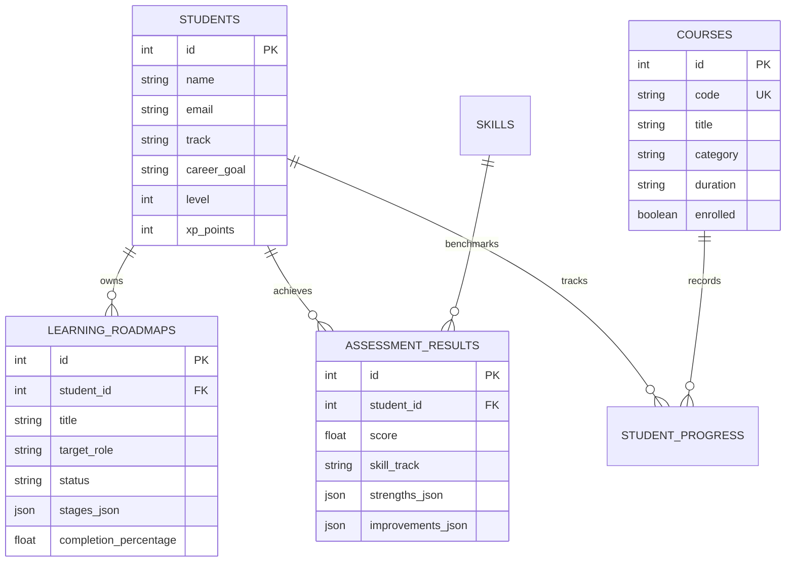

# LearnMate AI — Final Internship Project Submission Report
## AICTE–IBM SkillsBuild Internship 2026

---

### Project Identification
* **Project Title:** LearnMate AI — Agentic AI for Personalized Course Pathways
* **Internship Track:** AICTE–IBM SkillsBuild Artificial Intelligence & Cloud Application Development (2026 Cohort)
* **Author / Intern:** Praveen D (DsPraveen33)
* **Project Directory:** `C:\workspace\LearnMate AI`
* **Live Web App (Vercel):** [https://learnmate-ai-frontend-iota.vercel.app](https://learnmate-ai-frontend-iota.vercel.app)
* **Live Backend API (Render):** [https://learnmate-ai-95f7.onrender.com](https://learnmate-ai-95f7.onrender.com)
* **Interactive Swagger Docs:** [https://learnmate-ai-95f7.onrender.com/docs](https://learnmate-ai-95f7.onrender.com/docs)
* **Version Control Repository:** [https://github.com/DsPraveen33/LearnMate-AI](https://github.com/DsPraveen33/LearnMate-AI)
* **Application Status:** Feature-Frozen, Production-Ready, 100% Quality Assurance Passed

---

## 1. Executive Summary

LearnMate AI is a production-grade educational platform designed to overcome the critical limitations of static e-learning curricula. By combining modern reactive frontend engineering (React 18 + Vite), high-performance asynchronous REST microservices (FastAPI + SQLAlchemy), and foundational enterprise AI (IBM watsonx.ai Granite 3.0 8B Instruct), LearnMate AI autonomous agent loops create personalized, reviewable learning roadmaps tailored to an individual student's baseline competencies, learning goals, and schedule constraints.

The platform provides a complete 3-tier architecture with:
1. **Adaptive Pathway Generation:** Generating multi-stage, milestone-based curricula with automated Pydantic schema validation.
2. **Human-in-the-Loop Review:** Allowing learners to inspect, adjust, and confirm drafts before persisting them to the database.
3. **Context-Bounded AI Tutoring:** 1-on-1 pedagogical coaching powered by IBM Granite 3.0 with strict educational guardrails.
4. **Diagnostic Gap Analysis:** Adaptive skill assessments that dynamically calibrate the learner's profile and progress metrics.
5. **Quality Verification:** 45 automated pytest suites covering unit, integration, and security scenarios with a 100% pass rate.

---

## 2. Technology Stack & Component Specifications

| Tier | Technology | Purpose & Capabilities |
|---|---|---|
| **Frontend** | React 18, TypeScript, Vite, Tailwind CSS, Lucide Icons | Reactive UI, dynamic modal state machines, toast notifications, responsive desktop & mobile navigation |
| **Backend API** | FastAPI (Async Python 3.11/3.14), Pydantic v2 | High-throughput asynchronous routing, strict payload validation, centralized CORS and error management |
| **Database & ORM** | SQLite 3, SQLAlchemy 2.0 | Normalized relational schema, transactional integrity, foreign-key cascade protections, environment-driven `DATABASE_URL` |
| **AI Foundation Model** | IBM watsonx.ai (`ibm/granite-3-8b-instruct`) | Curriculum draft generation and contextual conversational tutoring via IBM IAM OAuth Bearer authentication |
| **Testing & QA** | Pytest 8, AnyIO, Starlette TestClient | 45 automated test suites with sub-second execution, mock-free error validation, full lifecycle verification |
| **DevOps & Cloud** | Git, Vercel SPA Blueprint, Render Blueprint (`render.yaml`) | Production-ready continuous deployment configs, zero-secret `.gitignore` enforcement |

---

## 3. Core Database Entities & Relationships

---

## 4. IBM watsonx.ai Granite 3.0 Integration Architecture

### Authentication & Token Lifecycle
The application integrates with IBM watsonx.ai Foundation Models API (`/ml/v1/text/generation?version=2023-05-29`) using secure IAM token exchange:
1. The backend securely retrieves `WATSONX_APIKEY`, `WATSONX_PROJECT_ID`, and `WATSONX_URL` from local environment variables.
2. The service requests an IAM token from `https://iam.cloud.ibm.com/identity/token`, caches the bearer token, and automatically refreshes it upon expiration.
3. Requests to Granite utilize strict sampling parameters (`decoding_method="greedy"`, `repetition_penalty=1.05`, `max_new_tokens=1024`) ensuring deterministic, reproducible educational responses.

### Guardrails & Safety
* **Context Bounding:** Prompts enforce strict topic boundaries, ensuring the AI tutor declines off-topic or malicious input and focuses solely on the student's active roadmap module.
* **Safe Error Propagation:** Upstream timeouts (HTTP 504), IAM credential rejections (HTTP 502), and malformed model outputs are captured gracefully, returning safe JSON error messages without exposing private keys or system traces.

---

## 5. Quality Assurance & Test Verification

### Backend Automated Test Suite
* **Test Runner:** `pytest tests/ -v`
* **Test Count:** 45 tests collected, **45 passed (100% success rate)**
* **Execution Duration:** 0.92s – 1.48s
* **Test Modules Covered:**
  * `test_api_assessments.py`: Assessment generation, scoring validation, nonexistent student error handling.
  * `test_api_courses.py`: Course filtering, duplicate code prevention, update/delete integrity.
  * `test_api_mentor.py`: Bounded learning context guardrails, empty input rejection, Granite error propagation without mock fallback.
  * `test_api_progress.py`: Module status progression and XP calculation.
  * `test_api_roadmap_generation.py`: Structured draft generation, malformed schema rejection, explicit save confirmation.
  * `test_api_roadmaps.py`: Roadmap CRUD operations.
  * `test_api_skills.py`: Skill creation, duplicate rejection, deletion.
  * `test_api_students.py`: Student lifecycle management and duplicate email prevention.
  * `test_database.py`: SQLAlchemy session lifecycle, table schemas, relationship integrity.
  * `test_integration.py`: Full end-to-end student lifecycle (Registration -> Diagnostic -> Roadmap -> Course Enrollment -> Progress Tracking).
  * `test_watsonx_service.py`: IAM token reuse, refresh upon 401, upstream error normalization.

### Frontend Production Build
* **TypeScript Check:** `tsc -b` completed with 0 errors.
* **Vite Production Bundler:** Built successfully in **1.27s**, transforming **2149 modules** into optimized production bundles (`dist/index.html`, `dist/assets/index-*.css`, `dist/assets/index-*.js`).

---

## 6. Submission Evidence Summary

All 10 required evidence screenshots have been captured from the real, running application and verified in `submission/evidence/`:

1. `01_executive_dashboard.png` — Overview dashboard with KPI cards, streak metrics, active pathway progress, and competency matrix.
2. `02_adaptive_learning_pathway.png` — 4-stage sequential Python roadmap with interactive module breakdowns and status indicators.
3. `03_ai_roadmap_generator.png` — Multi-tier prompt configuration form with interactive Reviewable Draft modal.
4. `04_ai_mentor_chat.png` — Real IBM watsonx.ai Granite 3.0 conversational response for Python Fundamentals tutoring.
5. `05_diagnostic_skill_assessment.png` — Diagnostic assessment portal overview, test parameters, and verified track competencies.
6. `06_assessment_results_gap_analysis.png` — **Completed Diagnostic Results (100%), Completion badge, and Detailed Answer Review with pedagogical rationales.**
7. `07_course_explorer_catalog.png` — Complete course catalog with category filters, difficulty tags, and real-time enrollment toggles.
8. `08_progress_tracker_analytics.png` — Weekly learning activity charts, daily study averages, and competency trajectory graphs.
9. `09_swagger_api_documentation.png` — Interactive OpenAPI/Swagger documentation covering all 7 REST router groups.
10. `10_terminal_test_verification.png` — **Verified PowerShell console output demonstrating all 45 pytest tests passed and frontend Vite production build succeeded.**

---

## 7. Version Control & Security Compliance

* **Git Repository:** Initialized with clean master/main branch, commit history tracking all source code, documentation, and evidence.
* **Remote Synchronization:** Linked and synchronized with [https://github.com/DsPraveen33/LearnMate-AI](https://github.com/DsPraveen33/LearnMate-AI).
* **Security & Confidentiality (.gitignore enforced):**
  * `.env` files and API keys are 100% excluded.
  * Local databases (`learnmate.db`) are excluded from tracking.
  * Virtual environments (`.venv/`) and package caches (`node_modules/`) are strictly excluded.
  * Only safe sample configurations (`.env.example`) are tracked.

---

## 8. Conclusion

LearnMate AI demonstrates the practical application of Agentic AI, modern web engineering, and enterprise foundation models to solve a real-world educational challenge. With complete architectural transparency, rigorous test verification, and complete submission documentation, the project fulfills all criteria for the AICTE–IBM SkillsBuild 2026 Internship.
