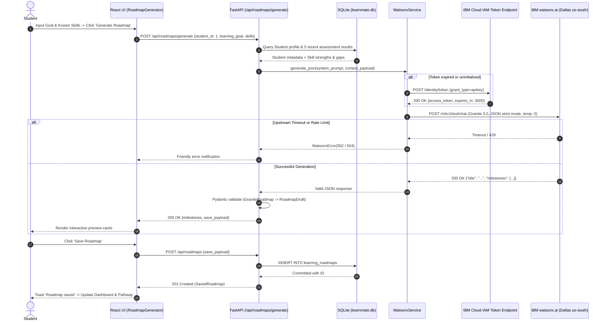
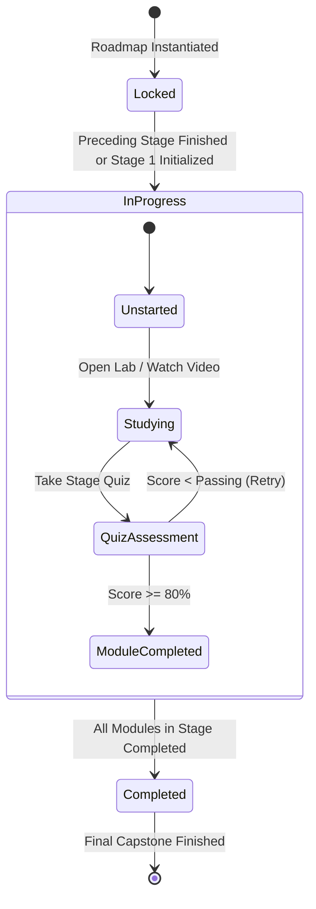

# LearnMate AI — Architectural & Agentic Workflow Diagrams

> **Project:** LearnMate AI — Agentic AI for Personalized Course Pathways  
> **Internship:** AICTE–IBM SkillsBuild 2026  
> **Diagramming Format:** Mermaid JS  

---

## 1. End-to-End Agentic Learning Workflow

This diagram outlines how a student moves from initial diagnostic assessment to AI-synthesized pathways, interactive mentoring, and milestone completion.

```mermaid
flowchart TD
    Start([Student Enters LearnMate AI]) --> Auth[Load Student Profile\nAlex Morgan / ID: 1]
    Auth --> Dash[Executive Dashboard Overview]
    
    Dash --> Assess[Take Diagnostic Skill Assessment]
    Assess --> Grade[Evaluate Score & Analyze Skill Gaps]
    Grade --> DB_Assess[(Save Assessment Result\nSQLite: assessment_results)]
    
    DB_Assess --> RoadGen[Launch AI Roadmap Generator]
    RoadGen --> PromptBuilder[Construct Dynamic Context:\n- Student Career Target\n- Learning Style Preference\n- Diagnostic Skill Gaps\n- Existing Competencies]
    
    PromptBuilder --> IAM_Auth[IBM Cloud IAM OAuth Exchange\n(Cached Bearer Token)]
    IAM_Auth --> GraniteInference[IBM watsonx.ai Granite 3.0 Inference\nStrict JSON Grammar Schema]
    
    GraniteInference --> SchemaVal{Pydantic v2\nGrammar Validation}
    SchemaVal -- Malformed --> ErrHandler[Return HTTP 502 / Safe User Alert]
    ErrHandler --> RoadGen
    
    SchemaVal -- Valid Output --> DraftPreview[Present Unsaved Draft to Student\nMilestones, Estimated Weeks, Modules]
    DraftPreview --> UserDecision{Student Approval}
    
    UserDecision -- Refine / Cancel --> RoadGen
    UserDecision -- Save Roadmap --> PersistRoadmap[(Persist LearningRoadmap\nSQLite: learning_roadmaps)]
    
    PersistRoadmap --> StudyPath[Active Learning Pathway View]
    StudyPath --> ModuleExec[Start Interactive Module / Lab]
    
    ModuleExec --> MentorHelp{Need Clarification?}
    MentorHelp -- Yes --> MentorChat[AI Study Mentor\nContext-Aware Tutoring]
    MentorChat --> ModuleExec
    MentorHelp -- No --> ProgressLog[(Update Progress & Log Time\nSQLite: student_progress)]
    
    ProgressLog --> CheckMilestone{Milestone Complete?}
    CheckMilestone -- Yes --> UnlockNext[Unlock Next Stage & Award XP]
    CheckMilestone -- No --> StudyPath
    UnlockNext --> Dash
```

---

## 2. IBM Granite Roadmap Synthesis Sequence

This sequence diagram depicts the exact interactions between the React Client, FastAPI, the SQLite Database, IBM Cloud IAM, and the watsonx.ai Granite LLM during pathway generation.



---

## 3. AI Study Mentor Guardrail & Prompt Architecture

This diagram demonstrates how untrusted user queries are sanitized, bound to the student's curriculum, and evaluated without allowing prompt injection.

```mermaid
flowchart LR
    UserQuery[Student Chat Input] --> BoundaryCheck{Boundary Validator}
    
    BoundaryCheck -- Empty or >2000 Chars --> Rejection1[HTTP 422: Input Length Error]
    BoundaryCheck -- Valid Length --> HistoryCheck{History Evaluator}
    
    HistoryCheck -- Non-alternating turns\nor >6000 total chars --> Rejection2[HTTP 422: History Malformed]
    HistoryCheck -- Valid Conversation --> ContextBuilder[Fetch Student's Saved Roadmap\nExtract Milestone Titles Only]
    
    ContextBuilder --> PromptAssembler["Assemble Strict System Prompt:\n1. Role: LearnMate Study Mentor\n2. Context: Saved roadmap & history\n3. Instruction: Treat user inputs as context ONLY\n4. Output: Strict single JSON object with 'reply'"]
    
    PromptAssembler --> GraniteModel[IBM Granite 3.0 Inference]
    GraniteModel --> ReplyValidator{Validate MentorReply}
    
    ReplyValidator -- Non-JSON / Empty --> BadGateway[HTTP 502: Invalid Model Response]
    ReplyValidator -- Valid Object --> Deliver[Return MentorReply {reply}\nRender in React Chat UI]
```

---

## 4. Module & Stage Progression State Machine

This state chart visualizes the life cycle of individual modules and learning stages.


